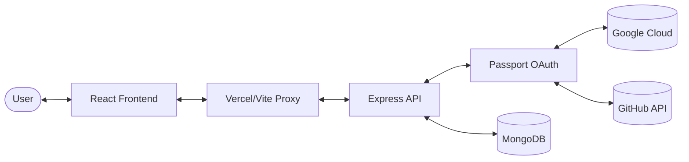

# 📓 Notes App - Full Stack Note Management


A sophisticated, full-stack note-taking application designed for modern workflows. Built with **React 19**, **Vite 7**, **Tailwind CSS 4**, **Node.js**, **Express 5**, and **MongoDB**. Featuring secure OAuth-based authentication and a premium, glassy UI experience.

---

## ✨ Project Showcase


> **Live Demo:** [notes-app-six-sable-89.vercel.app](https://notes-app-six-sable-89.vercel.app)

---

## 🚀 Key Features

- **🔐 Secure Authentication:** Seamless login via Google and GitHub OAuth 2.0 integration.
- **📝 Real-time CRUD:** Effortlessly create, read, update, and delete notes with instant UI feedback.
- **🎨 Modern Glassmorphism:** A premium UI featuring glassy translucent cards, animated background gradients, and sleek transitions.
- **📱 Responsive by Design:** Fully optimized for all devices with a custom mobile navigation system.
- **⚡ Performance First:** Built with Vite 7 for lightning-fast development and optimized production builds.
- **🧘 User Privacy:** Notes are securely scoped to individual user accounts.

---

## 🛠️ Tech Stack

### Frontend
- **Framework:** [React 19](https://react.dev/)
- **Build Tool:** [Vite 7](https://vitejs.dev/)
- **Styling:** [Tailwind CSS 4](https://tailwindcss.com/)
- **Icons:** [Lucide React](https://lucide.dev/)
- **Toasts:** [React Hot Toast](https://react-hot-toast.com/)
- **HTTP:** [Axios](https://axios-http.com/)

### Backend
- **Runtime:** [Node.js](https://nodejs.org/)
- **Framework:** [Express 5](https://expressjs.com/)
- **Auth:** [Passport.js](https://www.passportjs.org/) (Google & GitHub Strategies)
- **Database:** [MongoDB](https://www.mongodb.com/)
- **ORM:** [Mongoose 8](https://mongoosejs.com/)
- **Session:** [express-session](https://www.npmjs.com/package/express-session) + [connect-mongo](https://www.npmjs.com/package/connect-mongo)

---

## 📐 Architecture Overview



---

## 📁 Project Structure

```text
Notes-App/
├── backend/            # Express API, Mongoose Models, Auth Logic
│   ├── routes/         # API Route definitions
│   ├── models/         # MongoDB Schemas
│   └── passport.js     # OAuth Strategy Config
├── frontend/           # React Application (Vite + Tailwind)
│   ├── src/
│   │   ├── components/ # Reusable UI Components
│   │   ├── hooks/      # Custom React Hooks
│   │   └── App.jsx     # Main Application Entry
└── README.md           # Documentation
```

---

## ⚙️ Development Setup

### 1. Prerequisites
- **Node.js** v18+ 
- **npm** or **yarn**
- **MongoDB** account (Atlas)
- **Google & GitHub** Developer Credentials

### 2. Clone & Install
```bash
git clone https://github.com/chitranshuajmera0000/Notes-App.git
cd Notes-App

# Install Backend Dependencies
cd backend && npm install

# Install Frontend Dependencies
cd ../frontend && npm install
```

### 3. Environment Configuration
Create a `.env` in `backend/` and `.env.local` in `frontend/`.

**Backend `.env`:**
```env
MONGO_URI=your_mongodb_connection_string
PORT=3000
SESSION_SECRET=your_super_secret_key
FRONTEND_URL=http://localhost:5173

GOOGLE_CLIENT_ID=your_google_id
GOOGLE_CLIENT_SECRET=your_google_secret
GOOGLE_CALLBACK_URL=http://localhost:3000/api/auth/google/callback

GITHUB_CLIENT_ID=your_github_id
GITHUB_CLIENT_SECRET=your_github_secret
GITHUB_CALLBACK_URL=http://localhost:3000/api/auth/github/callback
```

**Frontend `.env.local`:**
```env
VITE_API_URL=http://localhost:3000/api
```

### 4. Running the App
**Terminal 1 (Backend):** `cd backend && npm run dev`  
**Terminal 2 (Frontend):** `cd frontend && npm run dev`

---

## 🔌 API Documentation

### Authentication
- `GET /api/auth/google` - Initiate Google login
- `GET /api/auth/github` - Initiate GitHub login
- `GET /api/auth/user` - Fetch authenticated user data
- `GET /api/auth/logout` - Securely log out user

### Notes (Protected Routes)
- `GET /api/notes` - Retrieve all notes for current user
- `POST /api/notes` - Create a new note
- `PUT /api/notes/:id` - Update an existing note
- `DELETE /api/notes/:id` - Remove a note

---

## 🤝 Contributing & Support

Contributions are welcome! If you find a bug or have a feature request, please open an issue.

- **Author:** [Chitranshu Ajmera](https://github.com/chitranshuajmera0000)
- **Repo:** [Notes-App](https://github.com/chitranshuajmera0000/Notes-App)

---

## 📜 License

Licensed under the **MIT License**. See `LICENSE` for details.

*Crafted with ❤️ for a seamless note-taking experience.*

